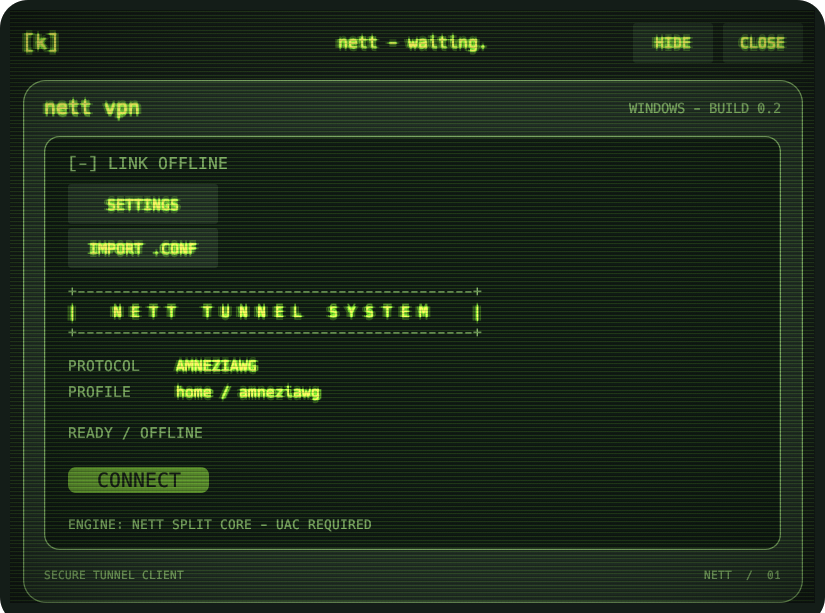

<div align="center">

```text
                       _   _
             _ __   ___| |_| |_
            | '_ \ / _ \ __| __|
            | | | |  __/ |_| |_
            |_| |_|\___|\__|\__|

          [ tunnel terminal / windows x64 ]
```


**Green phosphor. Encrypted profiles. Your routing rules.**

[download release](https://github.com/yorishu/nett-vpn/releases/latest) · [boot sequence](#01--b00t) · [routing](#03--r0ut3) · [build](#05--d3v)

</div>



## 00 // wh4t is this

`nett` is a Windows VPN client with a Rust interface styled after an old terminal: pixel-letter **k**, phosphor glow, scanlines, a vignette, a moving raster and short chromatic glitches.

Underneath: WireGuard and AmneziaWG, a DPAPI-encrypted profile library, site/app split tunneling and a tray that keeps the tunnel alive when the window is closed.

No browser shell. No Go installation needed to run it. VPN engines live beside the executable, not inside a pretend single-file bundle.

## 01 // b00t

```text
> download  nett-v0.2.4-windows-x64.zip
> extract   the whole archive
> launch    nett.exe
> import    your .conf
> connect   approve Windows UAC
```

Keep the extracted layout intact:

```text
nett.exe
engines/
  AmneziaWG/    official AWG engine + Wintun
  AmneziaBox/   Nett split core + Wintun + source + licenses
README.md
```

Normal AmneziaWG connections use the bundled official Windows engine. Normal WireGuard connections require [WireGuard for Windows](https://www.wireguard.com/install/). Enabling split tunneling selects the bundled Nett split core for either protocol.

Before upgrading, exit the previous copy through `qu1t`. Do not run two Nett instances against the same profile library.

## 02 // c0ntr0ls

| Input | Action |
| :--- | :--- |
| `SETTINGS` | Open the control deck above `IMPORT .CONF` |
| `PROFILES` | Import, select, rename or delete saved profiles |
| `SITES` / `APPS` | Configure split routing for the selected profile |
| `DISPLAY` | Change CRT effects and animation, even with VPN active |
| `SAVE & APPLY` | Save settings; `DISPLAY` saves display preferences only |
| `BACK` | Return; confirm before discarding unsaved changes |
| `F8` | Toggle CRT effects immediately |
| `HIDE` / `CLOSE` | Hide the window; keep the tunnel running |
| Tray → `s33` | Restore the window |
| Tray → `qu1t` | Stop the tunnel, then exit |

Profile and routing edits are locked while connected. Display preferences are saved independently and do not restart the VPN. Importing a profile also saves the current draft. Split lists are saved independently of engine validation; a connection error never clears saved rules. Successful saves retain the current settings tab. AWG boolean fields support on/off, yes/no, true/false and 1/0; empty optional fields are treated as unset. AWG PersistentKeepalive ranges such as 25-35 are preserved by the bundled split core; off disables keepalive.

The tray **k** is white when inactive and green when an engine is running. `wired` reports engine state, not a verified remote handshake. A failed disconnect or cancelled UAC leaves Nett open with an error instead of silently exiting.

## 03 // r0ut3

Each profile has separate site and application lists.

| Mode | Listed destinations | Everything else |
| :--- | :--- | :--- |
| `VIA VPN` | VPN | Direct |
| `DIRECTLY` | Direct | VPN |

With both lists enabled, explicit direct exceptions win. If either list is in `VIA VPN` mode, unmatched traffic defaults to direct; the VPN inclusions form a union.

```text
[sites]  example.com
         192.168.10.0/24
         host.ts.net:8766

[apps]   C:\Apps\Discord.exe
         C:\Apps\qbittorrent.exe
```

Domains include subdomains. App rules match full executable paths without case sensitivity. Add helper executables separately and restart apps after reconnecting.

Routing limits:

- Peer `AllowedIPs` still apply. A local rule cannot grant access beyond the peer configuration.
- Domain matching uses intercepted DNS or protocol sniffing. App-owned encrypted DNS and ECH can hide the domain; use IP/CIDR rules or adjust secure DNS in that app.
- VPN DNS uses the first IP in the profile DNS list, or `1.1.1.1` when none exists. Direct DNS uses Windows. Shared Windows DNS services are not isolated per app.
- The split AWG server endpoint needs an IPv4 address or hostname with an IPv4 DNS record. Nett resolves hostnames through Windows DNS before each connection, in the background. Unsupported config fields fail explicitly.

## 04 // l0cal vault

```text
%LOCALAPPDATA%\nett-vpn\profiles.dpapi
```

The library is encrypted with Windows DPAPI for the current account. Original import files are no longer needed. The old single-profile format is migrated automatically; startup does not automatically connect.

Engines also need working `.conf` / `.json` files. These files and logs can contain keys or network metadata; their directory ACL permits the current user, SYSTEM and administrators. Do not publish this directory or copy it into an issue.

CRT overlays do not capture clicks or keyboard focus. Windows reduced-motion preferences disable the animations. Ordinary labels cannot be selected; input fields retain normal editing.

## 05 // d3v

Requirements: a current Rust toolchain with edition 2024 support and a Windows linker. Clone, then:

```powershell
cargo build --release --locked
cargo test --release --locked
```

For local use, extract `engines/` from a release beside `target/release/nett-vpn.exe`. Binaries, local profiles and build caches are excluded from Git.

The split core is a Nett derivative of [Amnezia Box](https://github.com/amnezia-vpn/amnezia-box), pinned to `v1.260910.0`. To rebuild it, put Go **1.25.5** and Python on PATH:

```powershell
./scripts/build_split_engine.ps1
cargo test --release --locked -- --include-ignored
```

The script verifies the upstream archive checksum and applies the small lifecycle patch. Engine readiness includes PID and process creation time. A stop request calls the engine's normal cleanup path instead of abruptly killing it. Go is a build dependency for this sidecar only; Nett's UI stays Rust.

The test suite covers encrypted persistence, routing config generation, UI clicks and layout, display changes during an active connection, and tray lifecycle logic. Optional engine tests validate generated WG/AWG configs and start/stop a route-free instance. Live VPN traffic is not covered by these tests.

Isolated screenshot mode never opens the real vault or creates a tray:

```powershell
$env:NETT_PREVIEW_SCREEN = 'home' # profiles / sites / apps / display / glitch
$env:EFRAME_SCREENSHOT_TO = "$PWD/preview.png"
cargo run --release --features ui-preview
```

Screenshot builds exit automatically. **Do not distribute a `ui-preview` build**; build the release again without that feature.

## 06 // credits & source

- [AmneziaWG for Windows](https://github.com/amnezia-vpn/amneziawg-windows-client/releases/tag/3.1.0): signed engine and Wintun in the portable release.
- [Amnezia Box](https://github.com/amnezia-vpn/amnezia-box/tree/v1.260910.0): split-core base. Nett's modified engine source is included in the release under `engines/AmneziaBox/source.zip`.
- [egui / eframe](https://github.com/emilk/egui): native Rust interface.

Third-party licenses remain in `engines/`. See [split-core source notes](engines/AmneziaBox/SOURCE.md) for the pinned toolchain, build tags and changes. Nett split core is a derivative, not an official Amnezia Box binary.

```text
> end of transmission_
```
